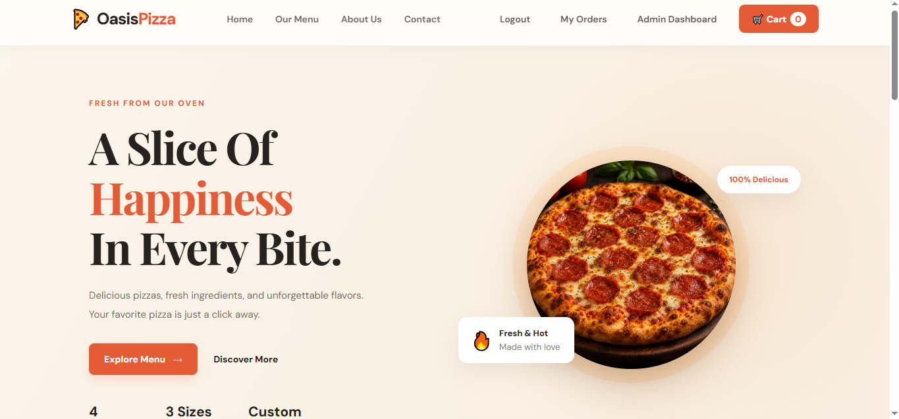
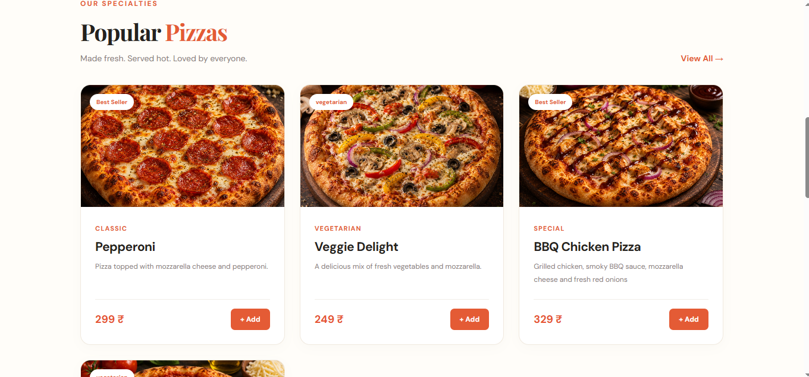
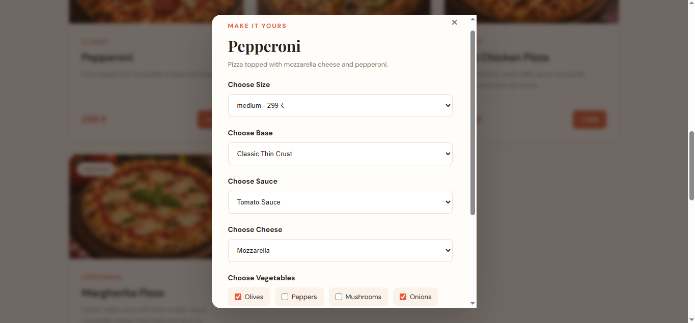
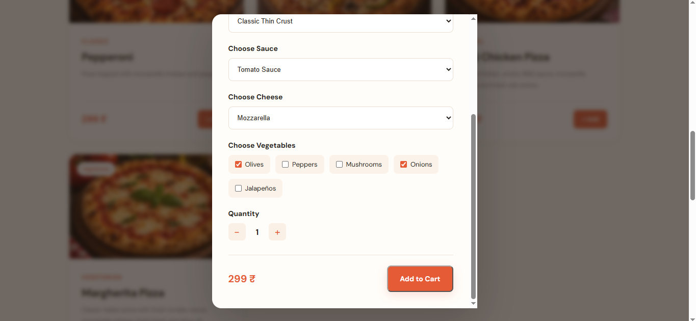
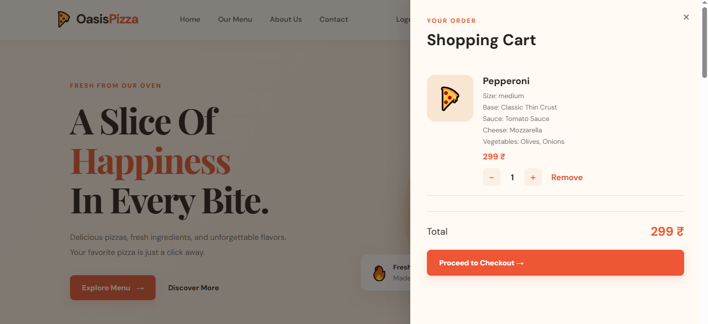
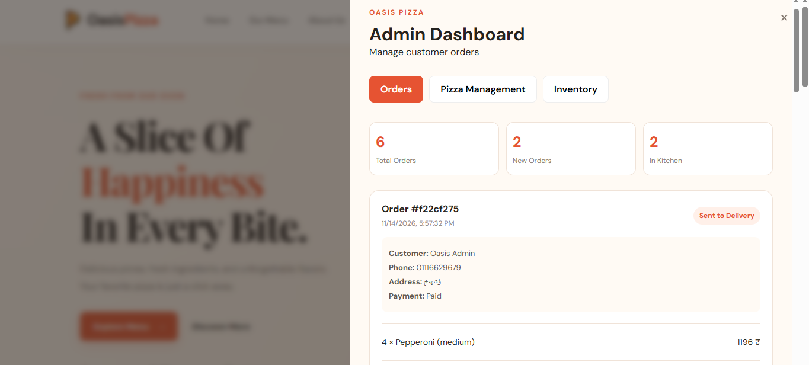

# 🍕 Oasis Pizza — Full-Stack Pizza Delivery Application

A full-stack pizza delivery web application developed as part of the **Oasis Infobyte Web Development Internship — Level 3, Task 1**.

Oasis Pizza allows customers to browse pizzas, customize their orders, add items to their cart, place orders, and track order status. It also provides an admin dashboard for managing pizzas, customer orders, and inventory.

## ✨ Features

### 👤 Customer Features
- User registration and login.
- Email verification.
- Forgot password and password reset.
- Browse available pizzas.
- Customize pizzas with different:
  - Pizza bases.
  - Sauces.
  - Cheese types.
  - Multiple vegetables.
- Add customized pizzas to the shopping cart.
- Place orders and view order summaries.
- View order history and track order status.

### 🛠️ Admin Dashboard
- Admin authentication and access control.
- Add, edit, and delete pizzas.
- Manage customer orders.
- Update order statuses.
- View and manage inventory.
- Add new inventory ingredients.
- Update ingredient quantities.
- Automatic inventory deduction after successful payment.
- Automated low-stock email alerts.

### 💳 Payment
- Mock payment flow for testing the order process.
- Inventory is deducted only after a successful mock payment.

> **Note:** The current implementation uses a mock payment system. It does not process real payments or integrate with Razorpay.

## 🧰 Tech Stack

**Frontend**
- React.js
- Vite
- CSS

**Backend**
- Node.js
- Express.js
- MongoDB
- Mongoose
- JWT Authentication
- bcrypt

**Additional Tools**
- Nodemailer
- Ethereal Email for testing email delivery
- node-cron for scheduled inventory checks
- Git and GitHub

## 📁 Project Structure

```text
WebDev-L3-PizzaDelivery/
│
├── backend/
│   ├── src/
│   │   ├── controllers/
│   │   ├── jobs/
│   │   ├── middleware/
│   │   ├── models/
│   │   ├── routes/
│   │   ├── scripts/
│   │   ├── services/
│   │   ├── utils/
│   │   └── server.js
│   ├── .env.example
│   ├── .gitignore
│   └── package.json
│
├── frontend/
│   ├── public/
│   │   └── images/
│   ├── src/
│   │   ├── assets/
│   │   ├── App.css
│   │   ├── App.jsx
│   │   ├── index.css
│   │   └── main.jsx
│   ├── .gitignore
│   ├── index.html
│   └── package.json
│
└── README.md
```

## ⚙️ Installation & Setup

### Prerequisites
- Node.js
- npm
- MongoDB Atlas account or a local MongoDB instance

### 1. Clone the Repository

```bash
git clone https://github.com/youssef-hassan1/OIBSIP.git
cd OIBSIP/WebDev-L3-PizzaDelivery
```

### 2. Backend Setup

```bash
cd backend
npm install
```

Create a `.env` file based on `.env.example` and configure the required environment variables.

Start the backend server:

```bash
node src/server.js
```

### 3. Frontend Setup

Open a second terminal:

```bash
cd frontend
npm install
npm run dev
```

Open the local URL displayed by Vite in your browser.

### 4. Environment Variables

Configure the following variables in `backend/.env`:

```env
MONGODB_URI=your_mongodb_connection_string
JWT_SECRET=your_secure_jwt_secret
API_URL=http://localhost:3000
ADMIN_EMAIL=your_admin_email
```

# Backend: backend/.env
MONGODB_URI=your_mongodb_connection_string
JWT_SECRET=your_secure_jwt_secret
API_URL=http://localhost:3000
ADMIN_EMAIL=your_admin_email

# Frontend: frontend/.env
VITE_API_URL=http://localhost:3000

## 📦 Inventory Management

The application includes an inventory management system that:
- Tracks available ingredients.
- Supports manual stock updates.
- Deducts ingredient quantities after successful payments.
- Checks for low-stock items automatically.
- Sends low-stock email alerts using a scheduled background job.

## 📸 Screenshots

### Home Page


### Pizza Menu


### Custom Pizza Builder




### Cart & Checkout


### Admin Dashboard


## 👨‍💻 Developer

**Youssef Hassan**

Full-Stack Web Developer

Developed as part of the Oasis Infobyte Web Development Internship.

## 📄 License

This project was developed for educational and internship purposes.
